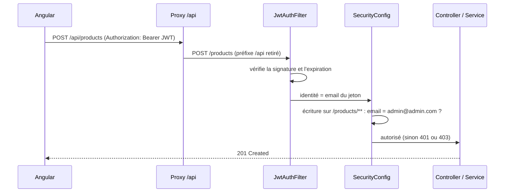

Mini e-commerce full-stack réalisé (l'énoncé d'origine est dans [CONSIGNES.md](CONSIGNES.md)).

- **Back** : Spring Boot 3.2 / Java 17, JPA, H2 (fichier), JWT (`back/`)
- **Front** : Angular 18 (composants standalone, signals) + PrimeNG (`front/`)

## Fonctionnalités

| Domaine | Contenu |
|---|---|
| Boutique | Liste détaillée des produits, recherche, filtre par catégorie, pagination, ajout au panier |
| Panier | Badge de quantité, page panier, ajustement des quantités (+/−), suppression, total |
| Liste d'envie | Ajout/retrait par un cœur sur chaque produit, page dédiée |
| Contact | Email et message obligatoires, message < 300 caractères, confirmation « Demande de contact envoyée avec succès » |
| Compte | Inscription et connexion (JWT) |
| Admin | Création, modification et suppression de produits, réservées à `admin@admin.com` |

## Architecture

```
product-trial-master/
├── back/                          Spring Boot
│   ├── pom.xml
│   ├── postman/                   Collection Postman (tests d'API)
│   └── src/
│       ├── main/java/com/alten/shop/
│       │   ├── model/             Product, AppUser, CartItem, WishlistItem (entités JPA)
│       │   ├── repo/              Repositories Spring Data
│       │   ├── service/           Logique métier (Auth, Product, Cart, Wishlist)
│       │   ├── security/          JwtService, JwtAuthFilter, SecurityConfig
│       │   ├── web/               Contrôleurs REST
│       │   └── DataSeeder.java    Charge products.json au premier lancement
│       ├── main/resources/        application.properties, products.json
│       └── test/                  ShopApiTest, ErrorStatusTest
└── front/src/app/
    ├── auth/                      AuthService, intercepteur HTTP, guard, page de connexion
    ├── products/                  data-access, liste produits, formulaire admin
    ├── cart/                      CartService (signals) et page panier
    ├── wishlist/                  WishlistService et page
    ├── contact/                   Formulaire de contact (+ test unitaire)
    └── shared/                    Accueil, menu latéral
```

Le back suit un découpage en couches `web → service → repo → model` : les contrôleurs ne contiennent que le mapping HTTP, la logique et les transactions sont dans les services.

### Flux d'une requête



## Choix techniques

### Back-end

| Choix | Raison |
|---|---|
| **H2 en fichier** (`back/data/`) | Persistance SQL sans rien installer. Se remplace par PostgreSQL en changeant l'URL et la dépendance. |
| **Spring Data JPA**, `ddl-auto=update` | Simple pour un test technique. En production : migrations Flyway/Liquibase. |
| **Contraintes d'unicité** (email, couple utilisateur/produit) | Garanties par la base, pas seulement par le code. |
| **Seed depuis `products.json`** | Données de démonstration identiques à celles du front d'origine. |
| **Bean Validation** (`@Valid`) | Rejet des données invalides en 400. |
| **springdoc** | Swagger UI sur `/swagger-ui.html`. |

### Sécurité

- **Mots de passe** hachés avec **BCrypt** (jamais stockés ni renvoyés en clair).
- **JWT signé HS256**, renvoyé par `POST /token`, durée de vie 120 minutes. Le secret doit faire au moins 32 octets : l'application refuse de démarrer sinon. En production, il se fournit par la variable d'environnement `APP_JWT_SECRET` ; la valeur par défaut ne sert qu'au développement.
- **API sans session** (`STATELESS`) : CSRF désactivé, car il n'y a pas de cookie à protéger.
- **Règle admin unique et générique** dans `SecurityConfig` : les écritures (POST, PUT, PATCH, DELETE) sur `/products/**` exigent que l'email du jeton soit `admin@admin.com`. Pas de gestion de rôles, comme demandé.
- **Codes HTTP distincts** : 401 = non authentifié ou jeton invalide ; 403 = authentifié mais non autorisé.
- **Panier et liste d'envie** rattachés à l'utilisateur du jeton (jamais à un identifiant fourni par le client) : un utilisateur ne peut pas lire ni modifier ceux d'un autre.
- **CORS** limité à `http://localhost:4200`.
- **Piège corrigé : le 401 qui masquait les erreurs.** Spring traite les erreurs (400, 403, 404) par un second passage interne sur `/error`, qui ne porte pas le jeton. Avec `anyRequest().authenticated()`, il répondait 401 à la place du vrai statut. Le correctif est `dispatcherTypeMatchers(ERROR).permitAll()` ; `ErrorStatusTest` le couvre, sur un vrai Tomcat.

### Front-end

| Choix | Raison |
|---|---|
| **Composants standalone + signals** | Pas de NgModule ; état réactif simple. |
| **Badge du panier** = `computed` sur les lignes du panier | Il se met à jour tout seul à chaque changement. |
| **Intercepteur HTTP** | Ajoute `Authorization: Bearer …` aux appels `/api/*`. |
| **Guard de route** | `/products` et `/cart` exigent une connexion. |
| **Jeton dans `localStorage`** | Simple et suffisant ici. Compromis : exposé en cas de XSS ; un cookie `HttpOnly` serait plus sûr en production. |
| **`isAdmin` côté front** | Sert seulement à afficher ou masquer les boutons. La vraie règle est appliquée par le back. |
| **Panier et wishlist synchronisés avec le back** | Les données suivent l'utilisateur d'un appareil à l'autre. |
| **Contact** : `Validators.maxLength(299)` | Équivaut à « inférieur à 300 ». L'envoi est simulé, car l'énoncé ne demande aucun endpoint. |
| **Proxy `/api` → `localhost:8080`** | Évite les problèmes de CORS en développement. |

## API

| Méthode | Route | Accès |
|---|---|---|
| POST | `/account` | public |
| POST | `/token` | public |
| GET | `/products`, `/products/{id}` | connecté |
| POST, PATCH, DELETE | `/products`, `/products/{id}` | admin |
| GET, POST | `/cart` | connecté |
| PATCH, DELETE | `/cart/{productId}` | connecté |
| DELETE | `/cart` | connecté (vide le panier) |
| GET | `/wishlist` | connecté |
| POST, DELETE | `/wishlist/{productId}` | connecté |

## Stratégie de test

- **`ShopApiTest`** (MockMvc) : 401 sans jeton, 401 avec un mauvais mot de passe, 403 pour un utilisateur normal et 201 pour l'admin sur l'écriture de produits, parcours complet du panier et isolation entre utilisateurs.
- **`ErrorStatusTest`** (vrai Tomcat, port aléatoire) : les erreurs gardent leur statut réel (400, 404, 403, 401). MockMvc ne simule pas le passage interne sur `/error`, d'où un test séparé.
- **Collection Postman** (`back/postman/`) : scénario de bout en bout avec assertions, sur un back lancé.
- **Front** : test unitaire du formulaire de contact (champs obligatoires, limite de 299 caractères, message de succès).

## Lancer le projet

Prérequis : JDK 17, Maven, Node 18+.

```bash
# Back (port 8080)
cd back
mvn spring-boot:run

# Front (port 4200), dans un autre terminal
cd front
npm install --legacy-peer-deps
npm start
```

Ouvrir http://localhost:4200. Pour le compte admin, s'inscrire avec `admin@admin.com`.

Tests du back : `cd back && mvn test`. Swagger : http://localhost:8080/swagger-ui.html.

## Limites connues et pistes d'amélioration

- Pas d'images produits : le seed ne fournit que des noms de fichiers (à déposer dans `front/src/assets/images/`).
- Pas de contrôle de stock à l'ajout au panier ni de passage de commande.
- Pas de rafraîchissement du jeton : à l'expiration, l'utilisateur est renvoyé à la connexion.
- Migrations de base à ajouter (Flyway) et PostgreSQL pour la production.
